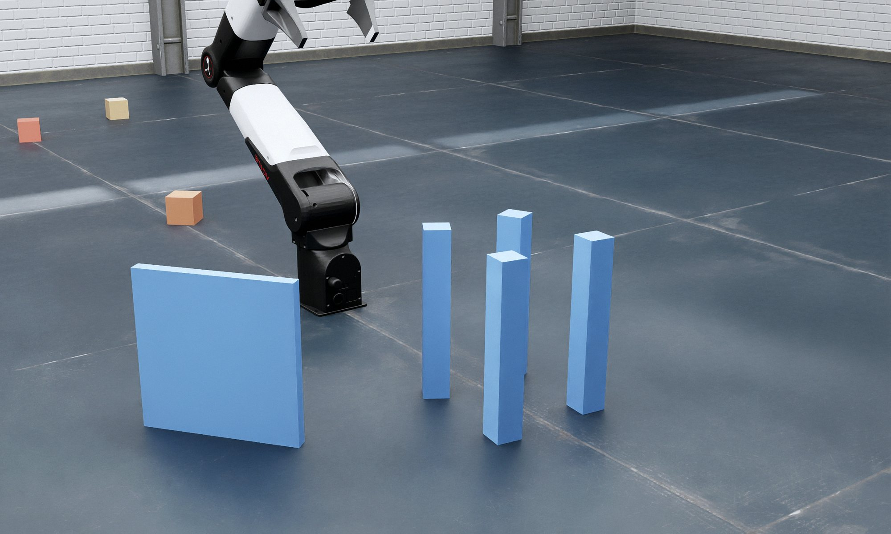
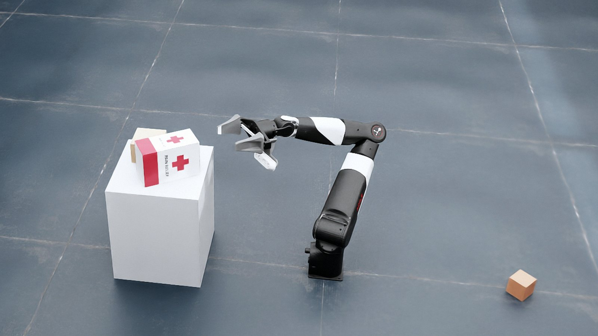
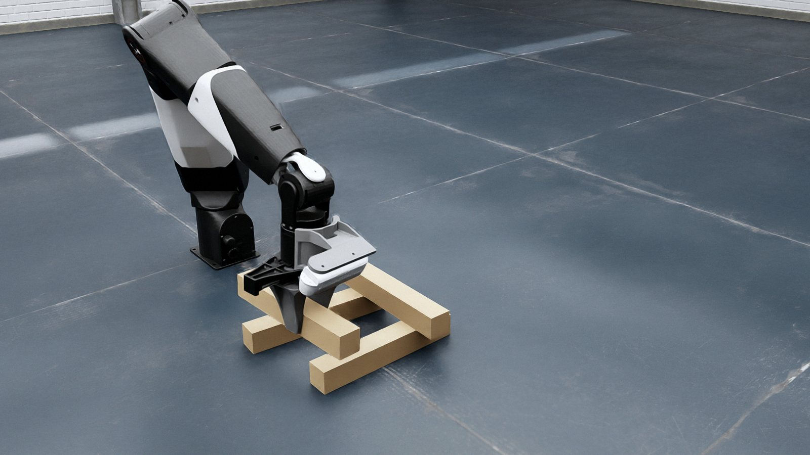
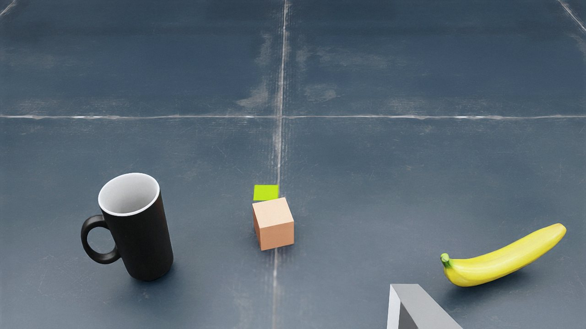
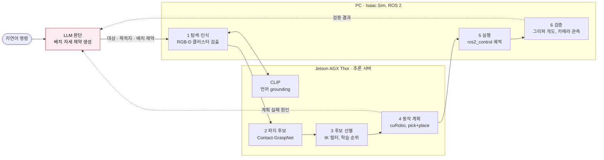

<div align="center">



# NERO Manipulation

**LLM 판단 기반 로봇 Pick-and-Place**

자연어 명령과 LLM이 생성한 배치 자세 제약으로 7-DoF 로봇팔의 pick-and-place를 계획·실행한다.

[**Project Page**](https://osj-nero.github.io/nero-project/) &nbsp;·&nbsp; [Demo](https://osj-nero.github.io/nero-project/#demo) &nbsp;·&nbsp; [How it works](https://osj-nero.github.io/nero-project/#how) &nbsp;·&nbsp; [About](https://osj-nero.github.io/nero-project/#about)


</div>

<br>

자연어 명령을 받아 물체를 탐색·파지하고, LLM이 생성한 **배치 자세 제약**(놓을 면과 방향)을 만족하는 pick-and-place 궤적을 계획한다. 제약을 만족하는 해가 없으면 실패 원인을 LLM에 피드백해 제약을 완화하거나 작업을 중단한다. 로봇은 AgileX NERO 7축 팔 + 평행 그리퍼 + 손목 RGB-D 카메라이며, 모든 실행은 NVIDIA Isaac Sim에서 이뤄진다.

*A language-driven pick-and-place system for a 7-DoF arm in Isaac Sim. An LLM decides where and in what pose to place each object; grasp candidates come from Contact-GraspNet and motions from cuRobo.*

> [!NOTE]
> 연구용 코드다. PC 1대 + Jetson 1대 구성에 맞춰 개발했으며, 다른 환경에서는 아래 절차를 따라 직접 맞춰야 한다.

## Tasks

<table>
<tr>
<td width="33%"></td>
<td width="33%"></td>
<td width="33%"></td>
</tr>
<tr>
<td valign="top"><b>01 · 의미 기반 배치</b><br>30cm 작업대 위 배치. 물체의 내용물과 용도를 근거로 LLM이 배치 자세 제약을 생성한다. 장애물로 막히면 제약 완화 또는 중단을 판단한다.<br><br><code>rq1/stage2_vlm.py</code></td>
<td valign="top"><b>02 · 정밀 배치</b><br>막대 부재로 井자·고인돌·삼각형·3층 구조를 조립하고, 기둥 4개 위에 판을 올린다. LLM이 구조 명세를 쓰고 코드가 검사한 뒤 실행한다.<br><br><code>precise/run_claude_tasks.py</code><br><code>precise/run_floor_pillars_lid.py</code></td>
<td valign="top"><b>03 · 다물체 분류</b><br>작업 영역을 스캔해 물체 목록을 구성하고, LLM이 MCP 도구 호출로 물체별 목적지와 실행 순서를 정해 순차 수행한다.<br><br>MCP <code>rt_survey</code> → <code>rt_sort</code></td>
</tr>
</table>

## Results

의미 기반 배치 과제. 16개 장면, 87 케이스, 케이스당 1회 실행.

| 조건 | 성공률 | 비고 |
|---|---|---|
| 장애물 없음 | **96%** (24 / 25) | pick-and-place 성공 |
| 장애물 있음 | **58%** (18 / 31) | 실패 13건은 모두 계획 성공 이후 실행 단계(파지·이송·배치)에서 발생 |

## How it works

파지 자세는 Contact-GraspNet, 궤적은 cuRobo가 계산한다. LLM은 배치 위치와 자세 제약만 결정한다.



| 단계 | 내용 |
|---|---|
| **1 탐색·인식** | 손목 RGB-D 카메라로 작업 영역을 스캔해 물체 클러스터를 검출하고, CLIP으로 명령의 대상에 grounding한다. |
| **2 파지 후보 생성** | 물체 점군에서 6-DoF 파지 후보 수백 개를 생성한다. |
| **3 후보 선별** | IK 도달성과 주변 물체 충돌로 후보를 걸러내고, 학습된 순위 모델로 정렬한다. |
| **4 동작 계획** | 파지와 배치 궤적을 함께 계획한다. 배치 자세가 LLM 제약을 만족하는 후보만 채택한다. |
| **5 실행** | ros2_control로 궤적을 실행한다. 파지 성공은 그리퍼 개도, 배치 결과는 카메라 관측으로 판정한다. |
| **6 검증·재판단** | 계획 실패나 배치 결과 불일치 시 원인을 LLM에 피드백한다. LLM은 제약을 완화하거나 작업을 중단한다. |

### 재판단 사례

작업대 위에 장애물이 있고, 상자에는 얇은 책이 들어 있는 장면의 실행 로그 요약. 제약 표기는 설명용 약식이다.

```text
USER     이 상자를 높은 작업대 위에 올려 줘
LLM      constraint = top_up          # 내용물이 쏟아지지 않도록 윗면 법선을 +z로 지정
PLANNER  infeasible                   # 도달 불가 또는 배치 영역 충돌. 원인을 LLM에 반환
LLM      constraint = not_top_down    # 윗면이 -z를 향하지만 않으면 허용하도록 완화
PLANNER  feasible                     # 측면 자세로 파지–배치 궤적 확보
ROBOT    작업대 위 측면 배치 완료
```

## System

PC는 x86 + NVIDIA GPU(Isaac Sim 구동), Thor는 NVIDIA Jetson AGX Thor다. Thor 역할은 GPU가 있는 다른 리눅스 서버로 대체할 수 있다.

| 위치 | 포트 | 코드 | 역할 |
|---|---|---|---|
| PC | — | `phase_c_L1/discover_object.py` (`rt_run.sh`) | 탐색–인식–파지–배치–검증 파이프라인 본체 |
| PC | 8020 | `pc_curobo/curobo_c_server.py` | cuRobo IK |
| PC | 9100 | `phase_c_L1/rt_mcp_server.py` (`mcp/rt_plus.py`) | LLM에 로봇 도구를 노출하는 MCP 서버 (nero-rt) |
| PC | — | `ros2_pkg/` (`planning_node`) | ROS 2 노드 (관측 자세 기록 등) |
| PC | — | `bringup/start_nero_isaac_all.sh` | Isaac Sim + ros2_control + MoveIt + 위 서버 일괄 기동 |
| Thor | 8012 | `thor/grasp/cgn_server_fp.py` | Contact-GraspNet 파지 후보 + 후보 선별(`two_pick_plan_fast.py`) |
| Thor | 8021 | `thor/curobo/curobo_c_server.py` | cuRobo pick-and-place 통합 계획 (배치 제약·충돌 검사) |
| Thor | 8030 | `thor/grasp/clip_ground_server.py` | CLIP ViT-L/14 언어 grounding |
| Thor | 8005 | `thor/vllm/serve_big.sh` (vLLM) | 로컬 멀티모달 LLM (Gemma 4) |

<details>
<summary><b>폴더 구조</b></summary>

```
phase_c_L1/     로봇 실행 본체: 탐색, 인식, 파지, 배치, 검증, 복구, MCP 서버
rq1/            과제 01 (의미 기반 배치): 장면 생성, LLM 판단, 채점
precise/        과제 02 (정밀 배치): 구조 명세 생성·검사·실행
contplace/      배치 제약 판정 공통 코드
goalpose_impl/  계획 서버 호출 유틸
mcp/            MCP 서버 확장 (호출 기록, 응답 보완)
pc_curobo/      PC cuRobo IK 서버
ros2_pkg/       ROS 2 패키지 sj_pickplace
bringup/        PC 기동 스크립트, RViz 시각화
thor/           Thor 쪽 서버 코드와 기동 스크립트 (grasp/, curobo/, vllm/)
config/         로봇 설정(cuRobo yml), 환경변수 예시
assets/         Isaac Sim 장면 (nero_simul.usd)
docs/           프로젝트 페이지 (GitHub Pages)
```

폴더 이름(`phase_c_L1`, `rq1` 등)은 개발 중 이름 그대로다. 스크립트가 이 이름으로 서로를 찾으므로 바꾸면 안 된다.

</details>

## Installation

### Requirements

| 구분 | 버전·출처 |
|---|---|
| PC | Ubuntu 22.04, ROS 2 Humble, NVIDIA Isaac Sim, Python 3.10 |
| Thor | ROS 2 Jazzy, CUDA |
| 로봇 모델·MoveIt 설정 | [agilexrobotics/agx_arm_sim](https://github.com/agilexrobotics/agx_arm_sim) (`nero_gripper_moveit_config`) |
| 동작 계획 | [cuRobo](https://github.com/NVlabs/curobo) (PC와 Thor 각각 가상환경) |
| 파지 후보 | [contact_graspnet_pytorch](https://github.com/elchun/contact_graspnet_pytorch) + 체크포인트 |
| Grounding | [OpenAI CLIP](https://github.com/openai/CLIP) ViT-L/14 |
| LLM | [vLLM](https://github.com/vllm-project/vllm) + `google/gemma-4-26B-A4B-it` |
| 분류 과제 물체 | [Google Scanned Objects](https://app.gazebosim.org/GoogleResearch/fuel/collections/Scanned%20Objects%20by%20Google%20Research) (USD 변환본) |

### PC

```bash
git clone https://github.com/osj-nero/nero-project.git ~/nero-manip
cd ~/nero-manip

# 1) 환경변수
cp config/nero_env.sh.example config/nero_env.sh    # Thor IP 등 값 채우기
source config/nero_env.sh

# 2) ROS 2 작업공간: 로봇 모델 + 이 저장소의 패키지
mkdir -p ~/ros2_ws/src && cd ~/ros2_ws/src
git clone https://github.com/agilexrobotics/agx_arm_sim.git
ln -s ~/nero-manip/ros2_pkg sj_pickplace
cd ~/ros2_ws && colcon build && source install/setup.bash

# 3) 로봇 설정 yml 의 경로 채우기
~/nero-manip/config/apply_paths.sh ~/ros2_ws

# 4) cuRobo 가상환경 (~/venvs/curobo) 은 cuRobo 설치 문서를 따른다.

# 5) Thor 에 ssh 별칭으로 접속되게 한다 (~/.ssh/config 에 Host thor, 키 인증)
ssh thor hostname
```

### Thor

```bash
git clone https://github.com/osj-nero/nero-project.git ~/nero-manip
~/nero-manip/thor/install_thor.sh        # 서버 코드를 ~/grasp, ~/nero/tools/phase_c_goalpose 등으로 복사
```

가상환경은 서버별로 분리한다: `~/grasp/cgn_venv`(Contact-GraspNet, CLIP), `~/venvs/curobo_thor`(cuRobo), `~/vllm-venv-g4`(vLLM).

### Model weights

저장소에는 가중치가 없다. 아래 파일을 Thor에 넣어야 한다.

| 파일 | 위치 | 출처 |
|---|---|---|
| Contact-GraspNet 체크포인트 | `~/grasp/contact_graspnet_pytorch/checkpoints/` | 원 저장소 |
| `ViT-L-14.pt` | `~/weights/clip/` | OpenAI CLIP |
| `phold_v1.joblib`, `place_reach_model.joblib` | `~/grasp/` | 이 저장소의 Releases |
| Gemma 4 | Hugging Face 캐시 | `google/gemma-4-26B-A4B-it` (이용 약관 동의 필요) |

## Usage

### 서버 기동

```bash
# Thor
~/grasp/thor_all.sh up                                   # MoveIt 스택 + CLIP(:8030)
cd ~/grasp && CGN_FP=10 CGN_PORT=8012 ~/grasp/cgn_venv/bin/python3 cgn_server_fp.py          # 파지 후보(:8012)
cd ~/nero/tools/phase_c_goalpose && NERO_NB_FIRST=1 NERO_CUROBO_BUDGET_SCALE=3.0 \
    ~/venvs/curobo_thor/bin/python curobo_c_server.py --port 8021                            # 계획(:8021)
MODEL=google/gemma-4-26B-A4B-it SERVED=qwen3-vl GPU_MEM_UTIL=0.45 MAXLEN=16384 MAXSEQ=8 \
    EXTRA="--quantization fp8 -cc.mode=none -cc.cudagraph_mode=FULL_DECODE_ONLY --max-num-batched-tokens 4096" \
    ~/vllm-venv/serve_big.sh                                                                 # LLM(:8005). 코드가 모델 이름 qwen3-vl 로 부른다

# PC
source ~/nero-manip/config/nero_env.sh
ssh -fN -L 8021:127.0.0.1:8021 thor                      # 계획 서버 터널
~/nero-manip/bringup/start_nero_isaac_all.sh             # Isaac Sim 이 뜨면 ▶(재생)을 눌러야 한다
```

### 01 · 의미 기반 배치

```bash
cd ~/nero-manip/rq1
S2V_SAME_PERC=1 python3 stage2_vlm.py blocked_v4/exec_vlm_cases.json     # LLM 판단
python3 stage2_rules.py blocked_v4/exec_vlm_cases87.json S,F,C           # 비교용 규칙 정책
```

장면 생성 → 인식 → LLM의 배치 제약 결정 → 계획·실행 → 채점을 한 번에 수행한다. 결과는 `rq1/stage2_vlm/`에 쌓인다.

### 02 · 정밀 배치

```bash
cd ~/nero-manip/precise
python3 run_claude_tasks.py jeong        # dolmen | jeong | jeong3 | triangle
FPL_AB=1 FPL_TWIST=20 FPL_CX=-0.42 python3 run_floor_pillars_lid.py demo 0.07    # 기둥 4개(간격 7cm) + 판
```

`run_claude_tasks.py`는 구조 명세 생성에 Claude(`claude` CLI)를 호출한다.

### 03 · 다물체 분류

MCP 클라이언트(예: Claude Code)에 `http://127.0.0.1:9100/mcp`를 `nero-rt`로 등록한 뒤 자연어로 지시한다.

```bash
cd ~/nero-manip/phase_c_L1 && python3 scene_sort.py S1       # 물체 여러 개 + 목적지 장면, /tmp/dests_S1.json 생성
```

```text
"책상 위 물건을 조사해서 장난감은 파란 보관함에, 나머지는 받침 위에 정리해줘"
  → rt_survey(dests_path)        장면 조사: 물체 표(id, 라벨 후보, 색, 크기, 위치)
  → rt_sort(plan, dests_path)    LLM 이 정한 계획을 순서대로 실행
  → rt_sort_status()             진행 확인
```

단일 물체는 `rt_pick`, `rt_place`로 지시할 수 있다.

## Notes

- **시뮬레이션 전용.** 채점과 일부 판정에 Isaac Sim의 ground-truth pose를 사용한다.
- 코드에 `ssh thor ...` 호출과 `~/grasp` 작업 폴더가 그대로 들어 있다. PC와 Thor의 사용자 홈 아래에 같은 `~/grasp` 경로가 있어야 한다.
- 동작 옵션은 대부분 `NERO_*` 환경변수다. 과제 스크립트가 필요한 값을 직접 설정하며, 기본값은 `rq1/exec_main.py`의 `ENV`에 있다.
- 계획기는 현재 도달 불가와 배치 영역 충돌을 구분해 보고하지 못한다.
- 코드 주석과 로그는 한국어다.
- 이 공개본은 개발 저장소에서 실제로 쓰는 파일만 골라 경로를 설정값으로 바꾼 것이다. 경로를 바꾼 뒤의 전체 동작은 공개 시점에 다시 확인하지 못한 부분이 있을 수 있다. 문제가 있으면 Issue로 알려 주기 바란다.

## License & Acknowledgements

- 이 저장소의 코드: **MIT** ([LICENSE](LICENSE)). 아래 외부 구성 요소에는 적용되지 않는다.
- 로봇 모델·MoveIt 설정은 AgileX Robotics [agx_arm_sim](https://github.com/agilexrobotics/agx_arm_sim), 동작 계획은 NVIDIA [cuRobo](https://github.com/NVlabs/curobo), 파지 후보는 [Contact-GraspNet](https://github.com/NVlabs/contact_graspnet), grounding은 OpenAI [CLIP](https://github.com/openai/CLIP), LLM은 Google [Gemma](https://huggingface.co/google/gemma-4-26B-A4B-it)를 사용한다. 각각의 라이선스와 이용 약관을 따른다.

## Citation

논문 정보는 게재 후 추가한다.

---

<div align="center">

오세준 · 서강대학교 대학원 BPDL (Robot Learning)

 &nbsp;&nbsp;&nbsp; 

<sub>LG이노텍–서강대학교 산학장학생 트랙 지원 포트폴리오</sub>

</div>
